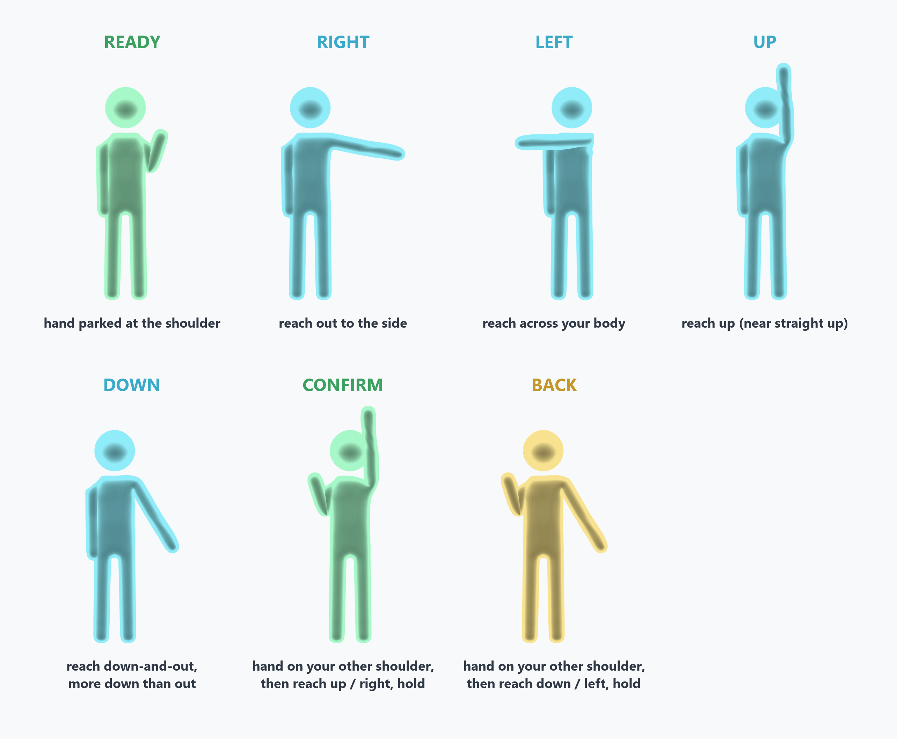

# KinectNavigator

Hands-free menu navigation for the Just Dance **Legacy Offline PC** mod, driven by Kinect
skeleton poses — **Kinect v1 or Kinect v2**, same gestures on both — so a dancer can browse the
song list and start a routine without touching a keyboard or phone.

**Get it:** grab the latest [release](../../releases), unzip it anywhere, run
`KinectNavigator-GUI.bat`, pick your language, point it at your game folder, click Install, close.

**Guides:** [`docs/setup.md`](docs/setup.md) — install & troubleshooting ·
[`docs/setup-kinectv2.md`](docs/setup-kinectv2.md) — getting a Kinect v2 sensor working ·
[`docs/usage.md`](docs/usage.md) — gestures, the diagnostic HUD, and tuning, in depth.

## Gestures at a glance

Wake it by resting your **dominant hand near your shoulder**. It goes back to sleep when that
hand sits out of play — not reaching in any direction — for a moment, i.e. when you lower your
arm.

Then picture a small `+` centred on that shoulder:

| Do this | Gets you |
|---|---|
| reach your hand **out to the side** | ◀ / ▶ |
| reach **up** | ▲ |
| reach **down-and-out** to the side | ▼ |
| hold the reach | key repeats (speeds up) |
| bend the elbow / bring the hand in | stops |

For **Enter / Esc**: put your *other* hand on your *other* shoulder, then reach **up or right
and hold** (Enter) / **down or left and hold** (Esc).

**Two players?** Kinect v1 tracks two people at once (Kinect v2 up to six) and any of them can
drive. Whoever does the wake gesture **last** takes control, and only that person's reaches
send keys — so the other one can move freely without stealing the menu. Details in
[`docs/usage.md`](docs/usage.md#more-than-one-player).



Full walkthrough, positioning tips, and every setting: [`docs/usage.md`](docs/usage.md).

## Install

Three ways, all doing the same swap (details in [`docs/setup.md`](docs/setup.md)):

1. **`KinectNavigator-GUI.bat`** — a small window: pick a language, point it at the
   game folder, Install. Doubles as a live editor for the common settings (navigation hand,
   mirror, Back gesture, HUD, feel presets, key bindings), ships in 12 languages, shows when an
   update is available, and is fully portable (its own `config.txt` in the release folder).
2. **`KinectNavigator-Console.bat`** — the same tool, same settings, as a text menu instead of
   a window.
3. **By hand** — rename the game's `Kinect10.dll` → `Kinect10_backend.dll`, drop the release's
   `Kinect10.dll` in its place (and the same pair for `Kinect20.dll`, if you use a Kinect v2),
   launch.

The installer puts in both the Kinect v1 and Kinect v2 proxies, so the same install works with
whichever sensor you plug in. The proxies run on compiled-in defaults; a `kinectnav.ini` next to
them overrides thresholds with no rebuild, and is entirely optional. Players need the
**Kinect for Windows Runtime v1.8** for a v1 sensor, or the Kinect v2 runtime for a v2 sensor
(see [`docs/setup.md`](docs/setup.md) and [`docs/setup-kinectv2.md`](docs/setup-kinectv2.md)).

## Diagnostic HUD

An optional dark panel (top-left) showing what the recogniser sees — tracking state, a live
d-pad, distance, action feedback. **Off by default**; a troubleshooting aid, not needed for
normal play. It's a layered window, so exclusive-fullscreen DirectX hides it — run the game
windowed / borderless to use it. Details in [`docs/usage.md`](docs/usage.md#the-diagnostic-hud).

## Build from source

Visual Studio 2022 or later, **Desktop C++** workload (x86 tools), and the **Kinect for
Windows SDK 2.0** (headers only, for `Kinect20.dll`; the build stops with a clear message if
`KINECTSDK20_DIR` isn't set). The Kinect v1 proxy needs no SDK: it does not link `Kinect10.lib`,
and its skeleton structs are vendored in `nui_types.h`.

```
build.cmd
```

or `msbuild src\KinectNavigator.sln /p:Configuration=Release /p:Platform=Win32`. Output is
`build\Win32\Release\Kinect10.dll` and `Kinect20.dll`, also copied to `dist\` and `dist\app\`.

Shared code (the recogniser, config, HUD) lives in `src\nav_core\`; each proxy project
(`src\KinectNavigator\` and `src\KinectNavigatorV2\`) adds only its own sensor hookup.

A build must keep `dumpbin` clean. `Kinect10.dll`: exactly the 8 `Nui*` ordinals (base 5),
machine x86, imports `KERNEL32 + USER32 + GDI32 + SHELL32` only, no self-import of
`Kinect10.dll`. `Kinect20.dll`: exactly one export, `GetDefaultKinectSensor`, machine x86, same
import set, and it must never import `Kinect20.dll` (that would be itself).

## How it works

KinectNavigator is a single drop-in `Kinect10.dll` that sits **between** the game and the real
Kinect runtime. It exports the eight `Nui*` ordinals `legacy.exe` imports, forwards every call
to a renamed `Kinect10_backend.dll` (the genuine Microsoft runtime — or a webcam emulator's
fake DLL), and reads the skeleton frame on its way past. A background thread turns hand pose
into arrow / Enter / Esc keystrokes with `SendInput`, only while the game window is focused.

Only the game ever opens the sensor, so the Kinect v1 "two apps can't share one sensor"
problem never comes up.

Kinect v2 works the same way with a second drop-in, `Kinect20.dll`. The game imports one
function from it (`GetDefaultKinectSensor`); the proxy forwards it to the renamed genuine
runtime (`Kinect20_backend.dll`), hands the game its real sensor untouched, and opens its own
second body reader on that sensor in the background (Kinect v2 allows several readers). Both
sensors feed the same recogniser, so the gestures are identical.

## Antivirus

`Kinect10.dll` and `Kinect20.dll` are unsigned and they synthesise keystrokes and hook the game's imports — both
are textbook malware behaviours, so SmartScreen or your AV may flag it. It is a false
positive. The full source is here; build it yourself if you'd rather not trust the release
binary. See [`docs/setup.md`](docs/setup.md#troubleshooting).

## Credits

- **itsvexor** — *Legacy Sensor*, the webcam→Kinect emulator for this same mod. Confirmed the
  drop-in-`Kinect10.dll` approach; not affiliated.
- Skeleton structs vendored in `nui_types.h` are the public Kinect for Windows SDK 1.8
  layouts (Microsoft), used for ABI interop only.

## License

MIT — see [`LICENSE`](LICENSE). This is clean-room interop code; it contains no Ubisoft or
Microsoft source and ships no game assets.

---

> Built with AI assistance — the recogniser was designed and iterated with Claude (Anthropic)
> and Gemini. The code, the design decisions, and every in-game test are real.
